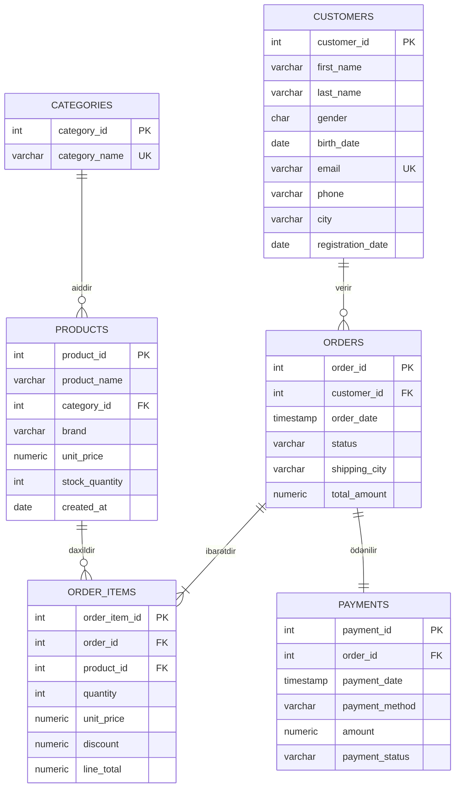

# Elektron ticarət verilənlər bazasının layihələndirilməsi

Magistratura sərbəst işi, mövzu 5. Müştəri, məhsul, sifariş və ödəniş məlumatlarından ibarət
əlaqəli **PostgreSQL** bazası layihələndirilir. Məlumatlar **Python (Pandas, NumPy)** ilə yaradılır,
təmizlənir və təhlil edilir. Satış göstəriciləri SQL (JOIN, GROUP BY, HAVING, CTE, Subquery)
vasitəsilə araşdırılır.

## Texnologiyalar

| Sahə | Alət |
|---|---|
| Dil | Python 3.12+ |
| Məlumat emalı | Pandas, NumPy |
| Verilənlər bazası | PostgreSQL 16 (Docker) |
| Bazaya qoşulma | SQLAlchemy, psycopg2 |
| Vizuallaşdırma | Matplotlib |
| Fayl formatları | CSV, JSON, Excel (xlsx), Parquet |
| Versiya idarəetməsi | Git, GitHub |

## Layihənin strukturu

```
ecommerce-db-project/
├── data/
│   ├── raw/                 # xam məlumatlar (CSV, JSON, Excel) — qəsdən "çirkli"
│   └── processed/           # təmizlənmiş məlumatlar (CSV + Parquet)
├── sql/
│   ├── 01_schema.sql        # DDL: cədvəllər, PK/FK, CHECK, indekslər
│   └── 02_analytics.sql     # 12 analitik sorğu
├── src/
│   ├── config.py            # yollar və baza parametrləri
│   ├── generate_data.py     # sintetik dataset generatoru
│   ├── clean_data.py        # yükləmə, keyfiyyət yoxlanışı, təmizləmə
│   ├── numpy_stats.py       # NumPy ilə statistik təhlil
│   ├── pandas_analysis.py   # groupby() və pivot_table()
│   ├── load_to_db.py        # PostgreSQL-ə yükləmə və bütövlük yoxlanışı
│   ├── sales_report.py      # SQL sorğuları, qrafiklər, satış hesabatı
│   └── er_diagram.py        # ER diaqramının şəkli
├── reports/
│   ├── figures/             # PNG qrafiklər
│   ├── query_results/       # hər SQL sorğusunun nəticəsi (CSV)
│   ├── sales_report.xlsx
│   ├── sales_report.md
│   ├── numpy_statistics.csv
│   ├── data_quality_report.csv
│   └── pandas_analysis.xlsx
├── docs/                    # yekun hesabat (Word və PDF)
├── docker-compose.yml
├── run_pipeline.py          # bütün mərhələləri ardıcıl icra edir
├── requirements.txt
└── README.md
```

## Quraşdırma və işə salma

```bash
# 1. Virtual mühit və asılılıqlar
python -m venv .venv
.venv\Scripts\activate            # Windows
# source .venv/bin/activate       # Linux / macOS
pip install -r requirements.txt

# 2. PostgreSQL-i Docker ilə işə salmaq
docker compose up -d

# 3. Bütün pipeline (generasiya → təmizləmə → statistika → baza → hesabat)
python run_pipeline.py

# Bazasız yalnız Python hissəsi:
python run_pipeline.py --no-db
```

Bazaya qoşulma parametrləri (`src/config.py`, mühit dəyişənləri ilə dəyişdirilə bilər):

| Parametr | Dəyər |
|---|---|
| Host | `localhost` |
| Port | `5434` (standart 5432 ilə toqquşmasın deyə) |
| Baza | `ecommerce_db` |
| İstifadəçi / şifrə | `ecommerce` / `ecommerce123` |

Bazaya birbaşa psql ilə qoşulmaq üçün:

```bash
docker exec -it ecommerce_postgres psql -U ecommerce -d ecommerce_db
```

## Verilənlər bazasının strukturu

### ER diaqramı



### Cədvəllər

| Cədvəl | Qeyd sayı | Təsvir |
|---|---:|---|
| `categories` | 10 | Məhsul kateqoriyaları |
| `customers` | 2 000 | Müştərilər (10 şəhər) |
| `products` | 300 | Məhsul kataloqu |
| `orders` | 7 994 | Sifarişlər (2024–2025) |
| `order_items` | 16 817 | Sifariş sətirləri (orders ↔ products, çox-çoxa) |
| `payments` | 7 994 | Ödənişlər (orders ilə 1:1) |
| **Cəmi** | **35 115** | |

### Məhdudiyyətlər (constraints)

- **Primary Key**: hər cədvəldə `*_id`.
- **Foreign Key**:
  - `products.category_id → categories`
  - `orders.customer_id → customers` (`ON DELETE RESTRICT`)
  - `order_items.order_id → orders` (`ON DELETE CASCADE`)
  - `order_items.product_id → products`
  - `payments.order_id → orders` (`UNIQUE`, 1:1 əlaqə)
- **UNIQUE**: `categories.category_name`, `customers.email`, `(order_items.order_id, product_id)`.
- **CHECK**: müsbət qiymət və miqdar, `discount ∈ [0, 1]`, status dəyərləri siyahısı, `gender ∈ {M, F}`.
- **İndekslər**: bütün xarici açarlar, həmçinin `orders.order_date` və `orders.status`.

### Normallaşdırma

Sxem **3NF**-ə uyğundur. Kateqoriya adı ayrıca cədvəldədir, müştəri məlumatları sifarişdə
təkrarlanmır. `order_items.unit_price` qəsdən saxlanılır: bu, satış anındakı tarixi qiymətdir,
kataloq qiyməti sonradan dəyişə bilər. `orders.total_amount` və `order_items.line_total`
hesabat sürəti üçün saxlanılan törəmə sütunlardır, onların doğruluğu `load_to_db.py`-də yoxlanılır.

## Məlumatların təmizlənməsi

Xam məlumatlara real problemləri modelləşdirmək üçün qəsdən səhvlər əlavə olunub.
Hamısı `clean_data.py`-də aşkarlanır və düzəldilir (tam jurnal: `reports/data_quality_report.csv`):

| Problem | Həll |
|---|---|
| 40 təkrar müştəri, 25 təkrar sifariş | `drop_duplicates()` |
| `BAKI`, `" Gəncə "` kimi şəhər adları (120) | Kanonik şəhər siyahısı ilə standartlaşdırma |
| Boş e-poçt / telefon (30 + 30) | NULL saxlanılır (müştəri silinmir) |
| Boş məhsul qiyməti (6) | Kateqoriyanın median qiyməti ilə doldurulur |
| Mənfi və sıfır miqdar (25) | Sətir silinir |
| Mövcud olmayan məhsula istinad (5) | FK yoxlanışı ilə silinir |
| Boş ödəniş üsulu (20) | `unknown` |
| Ödəniş məbləği uyğunsuzluğu (756) | Təmiz sətirlərdən yenidən hesablanır |

## Analitik SQL sorğuları (`sql/02_analytics.sql`)

| № | Sorğu | Texnika |
|---|---|---|
| q01 | Kateqoriyalar üzrə gəlir və pay | JOIN, GROUP BY, window SUM |
| q02 | Aylıq gəlir və orta çek | GROUP BY, DATE_TRUNC |
| q03 | Sadiq müştərilər (>8 sifariş, >3000 AZN) | JOIN, GROUP BY, **HAVING** |
| q04 | Şəhər × ödəniş üsulu | JOIN, GROUP BY, **HAVING** |
| q05 | RFM müştəri seqmentasiyası | **CTE** (3 mərhələ), NTILE |
| q06 | Kateqoriya ortalamasından baha məhsullar | **Korrelyasiyalı subquery** |
| q07 | Ortadan 3 dəfə çox xərcləyən müştərilər | **Subquery** (IN, iç-içə) |
| q08 | İllik artım (YoY) | **CTE**, LAG |
| q09 | Ödəniş üsullarının uğur nisbəti | GROUP BY, FILTER |
| q10 | Hər kateqoriyada top-3 məhsul | **CTE**, ROW_NUMBER |
| q11 | Ləğv nisbəti yüksək kateqoriyalar | LEFT JOIN, **HAVING** |
| q12 | Yaş qrupu və cins üzrə davranış | **CTE**, CASE |

## Qrafiklər (`reports/figures/`)

1. Aylıq gəlir və sifariş sayı
2. Kateqoriyalar üzrə gəlir
3. Ödəniş üsulları üzrə statuslar
4. RFM seqmentləri
5. İllik müqayisə (2024 və 2025)
6. Sifariş məbləğlərinin paylanması
7. Şəhərlər üzrə satış

## Qeyd

Dataset sintetikdir. `generate_data.py` sabit `seed=42` ilə işləyir, ona görə nəticələr
hər dəfə eyni alınır. Paylanmalar real e-ticarət xüsusiyyətlərini əks etdirir: mövsümilik,
Pareto müştəri aktivliyi, Zipf məhsul populyarlığı, loqnormal qiymətlər.
